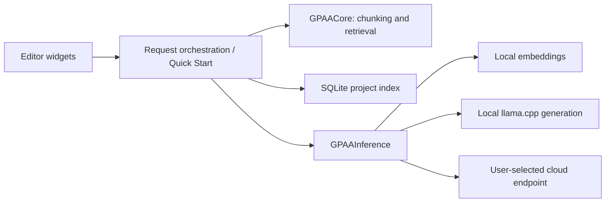

# Game Production AI Assistant

A Windows Unreal Editor plugin for local project search and source-aware AI answers, developed by **Maxime ESPRIT**.

Search code and asset metadata inside the editor. Generate answers with a downloaded local model or your own cloud provider. No companion application, Python service or Ollama installation is required by the native plugin.

## Current release scope

- Native plugin **0.3.0 beta**, Windows x64, Unreal Engine **5.6 and 5.8**.
- Local semantic search with bundled MiniLM embeddings; incremental SQLite project index.
- Asset / Code scopes and opening results in the asset or source editor.
- Local CPU generation using pinned llama.cpp and optional verified Qwen GGUF downloads.
- Optional OpenAI Responses or compatible streaming Chat Completions, using a personal key stored in Windows Credential Manager.
- First-run Quick Start, streamed conversation UI, cancellation and portable settings profiles.

Local prompts and project excerpts stay on the PC. Cloud mode sends selected context to the configured provider, whose pricing and data policies apply. Model capability and available context determine answer quality; verify references and generated code. Asset search uses metadata, not complete Blueprint graph analysis. GPU acceleration, macOS and additional Unreal versions are future work.

## Install and use

Use the package matching your engine version; keep only one active project/engine copy. Open **Tools > Game Production AI Assistant**. Search works before AI setup. Quick Start downloads the Light model (about 1.04 GiB) and verifies local generation; Settings also supports an explicit Cloud provider choice.

[User guide](docs/native-user-guide.md) · [Release notes](docs/native-release-notes.md) · [Fab listing material](docs/fab-listing-draft.md)

## Architecture



| Area | Responsibility |
|---|---|
| `plugin/Source/GPAACore` | Documents, passages, chunking, ranking and provider contracts |
| `plugin/Source/GPAAInference` | Embeddings, local model lifecycle/download integrity, local/cloud streaming and cancellation |
| `plugin/Source/GPAAssistant/Private/Application` | Project retrieval and request orchestration; Quick Start controller |
| `plugin/Source/GPAAssistant/Private/UI` | Main editor panel, conversation view and Quick Start presentation |
| `plugin/Source/GPAAssistant/Private/Infrastructure` | SQLite transactions and Windows credential storage |
| `scripts` | Pinned dependency preparation, packaging, exact-archive acceptance and release guards |

The C# projects are the **retained reference backend**, not an installation requirement for the native plugin. They show the earlier ports/adapters implementation and have their own hosted CI checks. See [reference developer guide](docs/developer-guide.md).

## Build and validate

Native build prerequisites: Windows, a supported Unreal installation, Visual Studio C++ tools and CMake. Dependency/model-card downloads are pinned by SHA256; chat weights are excluded from distribution archives.

```powershell
./scripts/package-native-plugin.ps1 -UnrealEngineRoot 'C:\Program Files\Epic Games\UE_5.8'
./scripts/test-native-plugin.ps1 -UnrealEngineRoot 'C:\Program Files\Epic Games\UE_5.8' `
  -PackagePath .gpaa/releases/GameProductionAIAssistant-native-v0.3.0-UE5.8-Win64.zip -TestFilter GPAA
```

The automated suite covers retrieval, persistence/migration, streaming, credentials UI, request cancellation, setup reset, conversation geometry and no-cloud-fallback behavior. Optional real-model acceptance is separate; passing fixture tests is not a guarantee of semantic accuracy on every project.

Reference backend: use .NET SDK 10 and runtime 8.

```powershell
dotnet build GameProductionAIAssistant.slnx --configuration Release
dotnet run --project GPAA.Tests/GPAA.Tests.csproj --configuration Release --no-build
```

## Releases and contributions

Version tags `vMAJOR.MINOR.PATCH` on reviewed `main` history request builds in a **separate private build repository**. The persistent PC runner is not intended to execute public PRs. After validation, complete ZIPs and checksums are published as GitHub Release assets; visibility follows the source repository. Fab submission remains a separate publisher action.

[Release setup and tag instructions](docs/releasing.md) · [Contributing](CONTRIBUTING.md) · [Security](SECURITY.md)

## License and third-party components

Original project code is under [MIT](LICENSE), copyright 2026 Maxime Esprit. This permits commercial reuse with the required notice. Third-party software retains its own licenses; the project license does not license Unreal Engine itself.

Read the [native dependency inventory](docs/native-third-party-notices.md). Supported engine installations supply their own engine dependencies. Distribution of editor binaries must respect applicable Unreal terms.

Support: **contact@maximeesprit.fr**. Please redact keys and private project content from reports.
